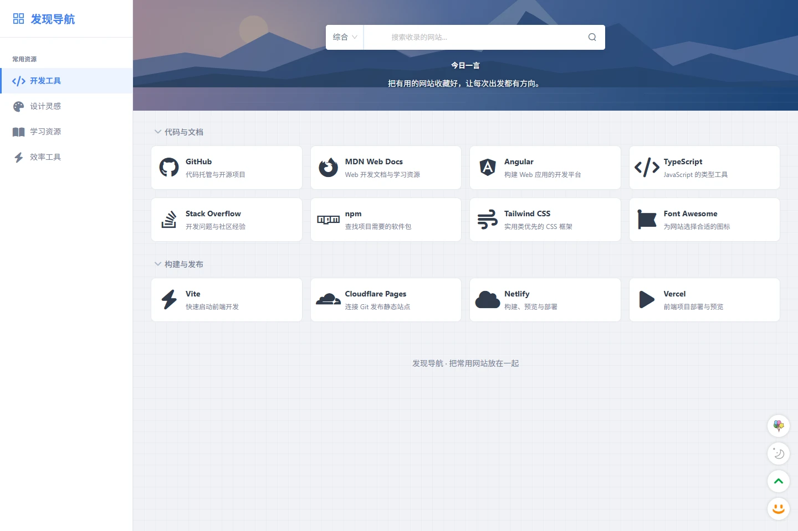
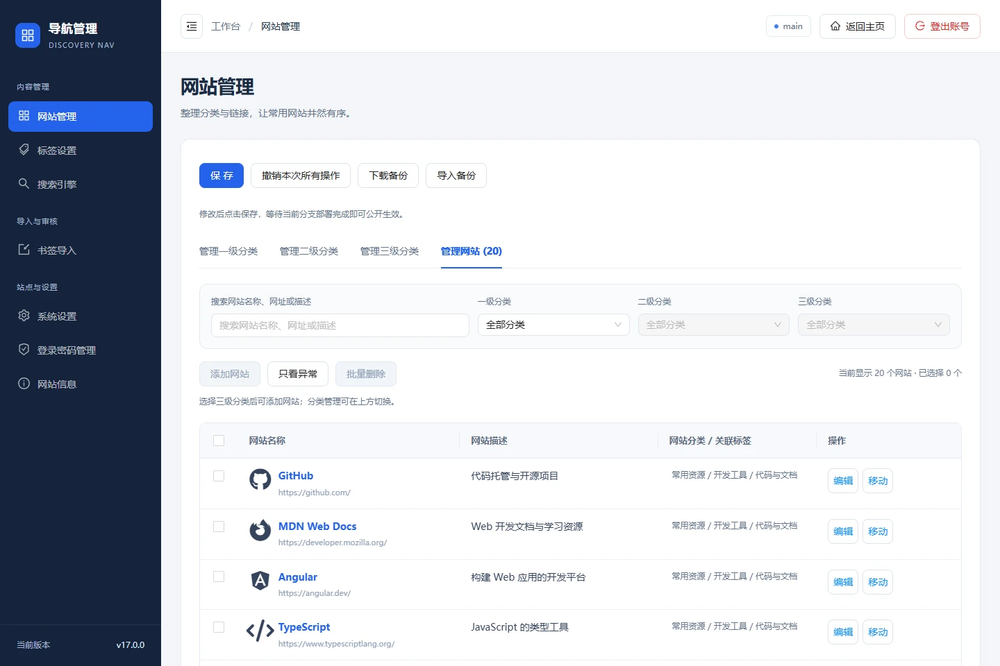
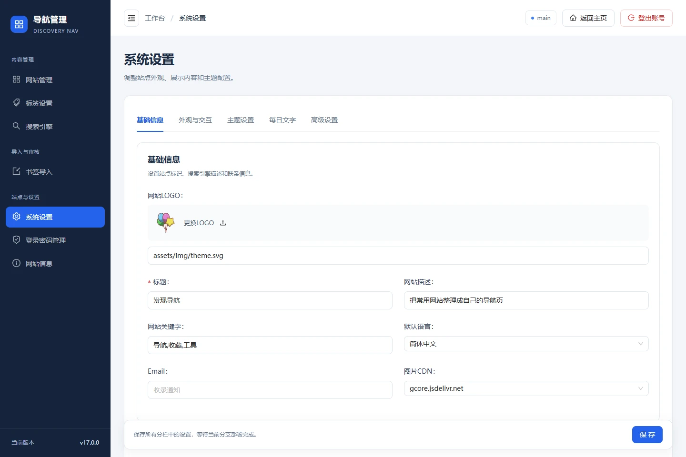
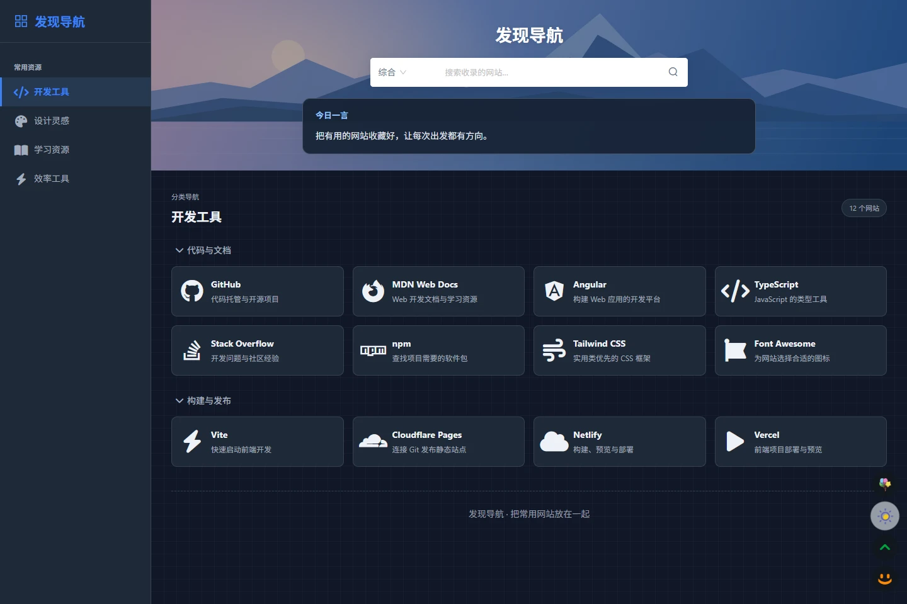
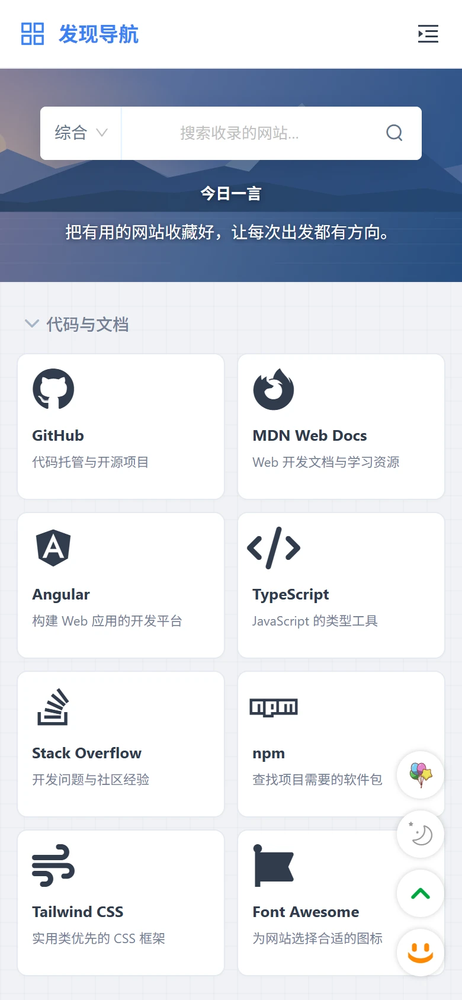

# 发现导航

把常用网站整理成自己的导航页。发现导航支持分类收藏、站内搜索、多种主题和在线编辑，适合个人工具箱、学习资源库或团队链接页。

网站可部署为静态文件，内容保存在 Git 仓库；登录后台后，就能维护网站和外观设置。

[English](README_EN.md) · [项目仓库](https://github.com/dragonadd/nav1) · [使用说明](docs/usage.md) · [部署](#部署)



## 功能

| 功能     | 可以做什么                                                                    |
| -------- | ----------------------------------------------------------------------------- |
| 整理收藏 | 使用三级分类和彩色标签整理网站，支持移动、引用、批量操作及书签导入 / 导出     |
| 快速查找 | 站内搜索、自定义搜索引擎，以及可以收藏和分享的固定分类链接                    |
| 选择外观 | Light、Super、Sim、Side、Shortcut、App 主题，支持暗色模式和手机布局           |
| 在线维护 | 编辑网站、分类、组件参数和设置，自定义网站信息获取接口，支持密码 / Token 登录 |
| 每日文字 | 所有主题均可展示每日一言、诗词或自定义文字，支持多个来源、日期变量和按天缓存  |
| 扩展页面 | 配置横幅、分类图标、日历、倒计时、图片、新闻、HTML 和手机 PWA                 |

项目使用 Angular 21、TypeScript 5.9、ng-zorro-antd 和 Tailwind CSS，支持 GitHub、Gitee、GitLab 仓库。

## 界面预览

截图使用示例导航数据，展示当前项目的实际界面。点击图片可查看大图。

| 网站管理                                                                        | 系统设置                                                                          |
| ------------------------------------------------------------------------------- | --------------------------------------------------------------------------------- |
| [](docs/images/admin.webp) | [](docs/images/settings.webp) |

<details>
<summary>查看暗色模式和手机界面</summary>





</details>

## 本地运行

准备 Node.js **22.12+ 或 24+** 和 pnpm **11**。

```bash
git clone https://github.com/dragonadd/nav1.git
cd nav1
pnpm install --frozen-lockfile
pnpm run start:reload
```

打开 [http://localhost:7002](http://localhost:7002)。后台入口是 `/system`。在线保存需要配置自己的 Git 仓库，并使用有写权限的 Token 登录。

## 部署

### 1. 配置仓库

Fork 项目或将源码上传到自己的 Git 仓库，在 [nav.config.yaml](nav.config.yaml) 填写仓库地址：

```yaml
gitRepoUrl: https://github.com/你的用户名/你的仓库
branch: auto
address: ''
hashMode: false
imageRepoUrl: ''
```

`branch: auto` 会跟随实际部署分支，后台内容和密码保存都提交到该分支。使用源码 ZIP 或没有 Git / 平台分支信息的构建环境时，填写具体分支名。

如需独立图床，填写 `imageRepoUrl`，并提前创建图床分支、授予写权限。GitLab 仓库还需提供 `projectId`，具体格式见 [配置说明](docs/usage.md#仓库与图床配置)。

### 2. 选择托管平台

构建命令为 `pnpm run build`，发布目录为 **`dist/browser`**。构建环境使用 Node.js **22.12+ 或 24+**，安装命令为 `pnpm install --frozen-lockfile`。

| 平台                                             | 操作                                                                                    |
| ------------------------------------------------ | --------------------------------------------------------------------------------------- |
| [Cloudflare Pages](https://dash.cloudflare.com/) | 创建 Pages 项目，连接仓库并选择生产分支；框架预设选“无”，填写构建命令和发布目录         |
| [Vercel](https://vercel.com/new)                 | 导入仓库，以仓库根目录为 Root Directory，填写构建命令和发布目录，选择 Production Branch |
| [Netlify](https://app.netlify.com/)              | 从 Git 导入仓库，选择部署分支，使用根目录 `netlify.toml` 的构建配置                     |

Cloudflare Pages 可设置 `NODE_VERSION=22.12.0`。需要自动发布预览分支时，在平台的分支控制中启用对应分支。自定义域名在托管平台的项目设置中配置。

### GitHub Pages

仓库包含 [GitHub Actions 发布工作流](.github/workflows/deploy-gh-pages.yml)：

1. 提交源码和配置，在 **Settings → Pages → Source** 选择 **GitHub Actions**。
2. 在 **Actions** 中启用工作流，选择 **Deploy to GitHub Pages → Run workflow** 和发布分支。
3. 部署成功后访问 `https://用户名.github.io/仓库名/`。

自动发布默认跟随仓库默认分支。使用其他分支时，在 **Settings → Secrets and variables → Actions → Variables** 设置 `NAV_PAGES_BRANCH`，值为分支完整名称。

工作流自动启用 Hash 路由，后台地址为站点地址加 `#/system`。发布分支后续的代码或后台内容提交会触发重新部署。

### 手动构建

```bash
pnpm run build

# GitHub Pages 手动构建：先在 YAML 设置 hashMode: true
pnpm run build-gh-pages
```

将 `dist/browser` 发布到静态托管服务。手动发布时，后台保存后也需要重新构建和上传。

## 开始使用

后台入口为 `/system`；Hash 路由使用 `/#/system`，子目录站点保留路径前缀。

1. **登录后台**：首次使用目标仓库的 Token 登录。可前往 [GitHub](https://github.com/settings/personal-access-tokens/new)、[Gitee](https://gitee.com/profile/personal_access_tokens) 或 [GitLab](https://gitlab.com/-/user_settings/personal_access_tokens) 创建 Token；GitHub 需要目标仓库的 Contents 读写权限。
2. **整理网站**：在“网站管理”中搜索、编辑、移动网站或维护分类。点击“保存”提交内容，等待当前分支部署完成后刷新查看。
3. **设置外观**：在“系统设置”中调整基础信息、主题、每日文字等内容。保存按钮提交所有分栏的修改。
4. **设置登录密码**：进入独立的“登录密码管理”，设置至少 8 个字符、包含字母和数字的密码。部署完成后可选择密码或 Token 登录。

Side 卡片支持登录后直接编辑；分类图标可填写图片网址或 Font Awesome 类名，如 `fas fa-film`、`fab fa-github`。

请使用专用 Token 和强密码，通过 HTTPS 或 localhost 使用密码功能。需要撤销访问时，在 Git 平台撤销 / 轮换 Token。凭证与会话说明见 [后台登录机制](docs/authentication.md)；主题、每日文字和备份操作见 [使用说明](docs/usage.md)。

## 常见问题

- **刷新后台出现 404**：History 路由需要 SPA 回退；GitHub Pages 使用 Hash 路由。
- **保存后没有看到更新**：查看最新部署是否成功，核对后台提交分支和平台发布分支。
- **图标或图片上传失败**：检查图床仓库、分支和 Token 写权限。
- **每日文字无法获取**：接口需要允许跨域访问；HTTPS 站点使用 HTTPS 接口，也可使用自定义文字。

## 开发与维护

```bash
pnpm test
pnpm run lint

# 构建后运行浏览器检查
pnpm run test:auth-ui
pnpm run test:themes
```

`src/view/` 是主题与后台页面，`src/components/` 是组件，`src/services/` 是服务，`data/` 保存导航与设置。升级或导入数据前，先备份自己的 `data/` 和 `nav.config.yaml`。

## 致谢与许可证

项目基于 [nav](https://github.com/xjh22222228/nav)，作者 xiejiahe。后台登录与每日文字参考 [NavBlog](https://github.com/dragonadd/Navblog)，Side 布局灵感来自 [墨鱼手记](https://ddgksf2013.top/)。

For commercial sites, themes, projects, and applications, keep your source code private/proprietary by purchasing a [Commercial License](https://official.nav3.cn/pricing).

Licensed under the GNU General Public License 3.0 for compatible open source projects and non-commercial use. See [LICENSE](LICENSE).

Copyright 2024-present xiejiahe
