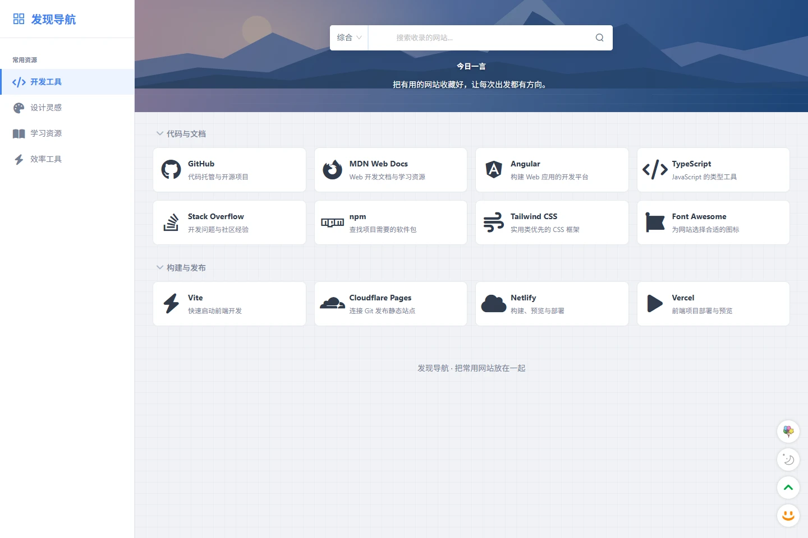
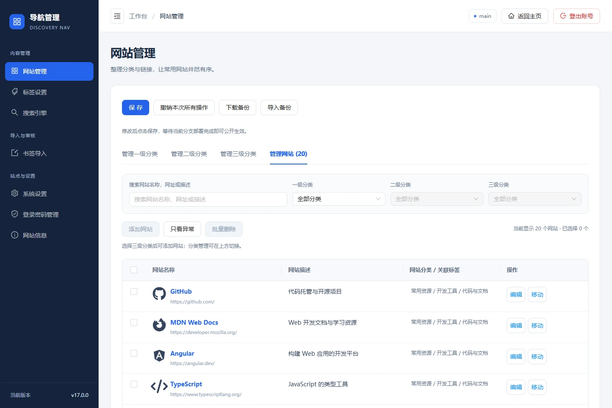
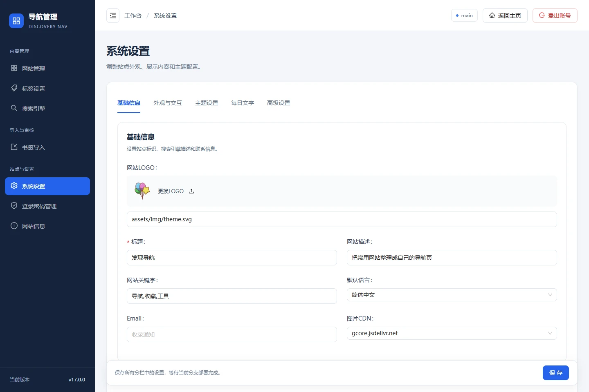
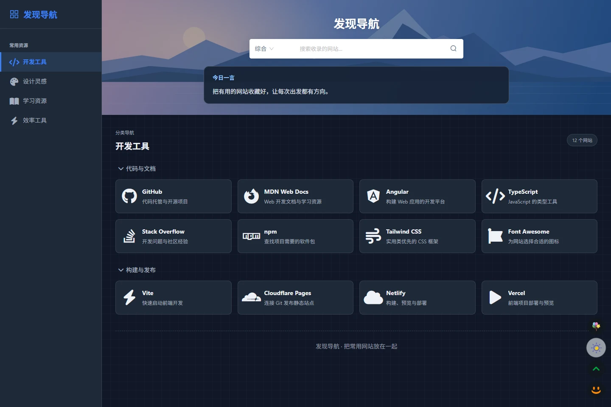
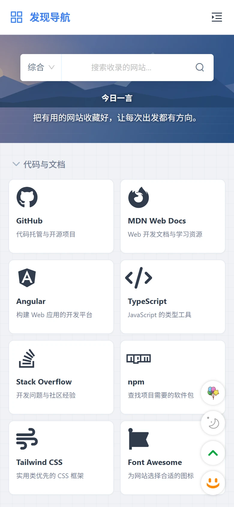

# Discovery Navigation

Keep your favorite websites in one place. Discovery Navigation combines categorized bookmarks, site search, multiple themes and online editing for a personal toolbox, learning library or team links page.

Deploy the website as static files and keep its content in a Git repository. The admin interface lets you maintain links and customize the site in your browser.

[简体中文](README.md) · [Repository](https://github.com/dragonadd/nav1) · [User guide](docs/usage_EN.md) · [Deployment](#deployment)



## Features

| Feature              | What you can do                                                                                     |
| -------------------- | --------------------------------------------------------------------------------------------------- |
| Organize bookmarks   | Three-level categories, colored tags, moving, references, bulk actions and bookmark import / export |
| Find links quickly   | Site search, custom search engines and stable category links you can bookmark or share              |
| Choose an appearance | Light, Super, Sim, Side, Shortcut and App themes, with dark mode and mobile layouts                 |
| Edit online          | Manage websites, categories and settings through password or Token login                            |
| Daily text           | Quotes, poetry and custom text with multiple sources, date variables and daily caching              |
| Customize pages      | Banners, category icons, calendars, countdowns, images, news, HTML widgets and mobile PWA settings  |

Built with Angular 21, TypeScript 5.9, ng-zorro-antd and Tailwind CSS. GitHub, Gitee and GitLab repositories are supported.

## Screenshots

These are actual project screens using sample navigation data. Click an image to view it at full size.

| Website management                                                                                       | System settings                                                                                |
| -------------------------------------------------------------------------------------------------------- | ---------------------------------------------------------------------------------------------- |
| [](docs/images/admin.webp) | [](docs/images/settings.webp) |

<details>
<summary>View dark mode and the mobile layout</summary>





</details>

## Local development

Use Node.js **22.12+ or 24+** and pnpm **11**.

```bash
git clone https://github.com/dragonadd/nav1.git
cd nav1
pnpm install --frozen-lockfile
pnpm run start:reload
```

Open [http://localhost:7002](http://localhost:7002). The admin route is `/system`. Online saving requires your own configured Git repository and a Token with write access.

## Deployment

### 1. Configure your repository

Fork the project or upload the source to your own Git repository. Set its URL in [nav.config.yaml](nav.config.yaml):

```yaml
gitRepoUrl: https://github.com/YOUR-USER/YOUR-REPOSITORY
branch: auto
address: ''
hashMode: false
imageRepoUrl: ''
```

`branch: auto` follows the actual deployment branch. Content and password commits target that branch. For source ZIPs or build environments without Git or platform branch metadata, specify the branch name.

To use a separate image repository, set `imageRepoUrl`, create its branch and grant write access. GitLab also requires `projectId`; see [repository configuration](docs/usage_EN.md#repository-and-image-configuration).

### 2. Choose a host

Build command: `pnpm run build`. Publish directory: **`dist/browser`**. Use Node.js **22.12+ or 24+** and install with `pnpm install --frozen-lockfile`.

| Host                                             | Setup                                                                                                                                           |
| ------------------------------------------------ | ----------------------------------------------------------------------------------------------------------------------------------------------- |
| [Cloudflare Pages](https://dash.cloudflare.com/) | Create a Pages project, connect Git and select the production branch. Use no framework preset and enter the build command and publish directory |
| [Vercel](https://vercel.com/new)                 | Import the repository, use its root as Root Directory, enter the build command and output directory, then select the Production Branch          |
| [Netlify](https://app.netlify.com/)              | Import from Git, select the deployment branch and use the root `netlify.toml` configuration                                                     |

On Cloudflare Pages, set `NODE_VERSION=22.12.0` if needed. Enable the relevant preview branches in the host's branch settings. Configure a custom domain in the hosting dashboard.

### GitHub Pages

The repository includes a [GitHub Actions deployment workflow](.github/workflows/deploy-gh-pages.yml):

1. Commit the source and configuration. In **Settings → Pages → Source**, choose **GitHub Actions**.
2. Enable workflows under **Actions**. Select **Deploy to GitHub Pages → Run workflow** and the publishing branch.
3. After deployment, visit `https://USER.github.io/REPOSITORY/`.

Automatic deployment follows the repository's default branch. To publish another branch, set the repository variable `NAV_PAGES_BRANCH` under **Settings → Secrets and variables → Actions → Variables** to its full name.

The workflow enables Hash routing. Append `#/system` to the site URL to enter the admin. Later source and content commits on the publishing branch trigger deployment.

### Manual builds

```bash
pnpm run build

# For a manual GitHub Pages build, set hashMode: true in YAML first
pnpm run build-gh-pages
```

Publish `dist/browser` to your static host. With manual publishing, rebuild and upload after saving content in the admin.

## Getting started

Open `/system`, or `/#/system` with Hash routing. Keep any subdirectory prefix.

1. **Sign in** using a Token for the target repository. Create one on [GitHub](https://github.com/settings/personal-access-tokens/new), [Gitee](https://gitee.com/profile/personal_access_tokens) or [GitLab](https://gitlab.com/-/user_settings/personal_access_tokens). GitHub requires Contents read / write access.
2. **Organize links** in Website management. Search, edit, move websites or maintain categories. Save the changes and wait for the current branch to deploy before refreshing.
3. **Customize the site** under System settings. Save submits changes from every tab, including theme and daily text options.
4. **Set a login password** in Login password management. Use at least eight characters containing letters and numbers. After deployment, you can choose password or Token login.

Side cards support editing after sign-in. Category icons accept image URLs or Font Awesome classes such as `fas fa-film` and `fab fa-github`.

Use a dedicated Token and a strong password; password features require HTTPS or localhost. To revoke access, rotate or revoke the Token on the Git platform. See [authentication details](docs/authentication.md) for credentials and sessions, and the [user guide](docs/usage_EN.md) for themes, daily text and backups.

## Troubleshooting

- **Refreshing admin returns 404:** History routing needs SPA fallback; use Hash routing on GitHub Pages.
- **Saved changes are missing:** check the latest deployment and verify that the admin commit branch matches the publishing branch.
- **Image uploads fail:** check the image repository, branch and Token write permissions.
- **Daily text is unavailable:** the API must support CORS. Use HTTPS APIs on HTTPS sites, or configure custom text.

## Development and maintenance

```bash
pnpm test
pnpm run lint

# Browser checks after building
pnpm run test:auth-ui
pnpm run test:themes
```

`src/view/` contains themes and admin pages, `src/components/` contains components, `src/services/` contains services and `data/` stores navigation and settings. Back up your `data/` and `nav.config.yaml` before upgrading or importing content.

## Credits and license

Based on [nav](https://github.com/xjh22222228/nav), by xiejiahe. Admin login and daily text reference [NavBlog](https://github.com/dragonadd/Navblog); the Side layout takes inspiration from [ddgksf2013.top](https://ddgksf2013.top/).

For commercial sites, themes, projects, and applications, keep your source code private/proprietary by purchasing a [Commercial License](https://official.nav3.cn/pricing).

Licensed under the GNU General Public License 3.0 for compatible open source projects and non-commercial use. See [LICENSE](LICENSE).

Copyright 2024-present xiejiahe
